<a id="01-capa"></a>

# HitTrack

### Análise de desempenho para robôs de combate

Transforma registros de lutas e hits em métricas temporais e comparações para equipes e analistas de robôs de combate.

[](https://www.python.org/)
[](https://react.dev/)
[](https://github.com/Olskaana/HitTrack/actions/workflows/ci.yml)
[](#23-autora)

**Projeto acadêmico Web App: PAC 8, 2026/2**

**Autora:** Ana Maria Olska · Universidade Católica de Santa Catarina

<a id="02-indice"></a>

## 2. Índice

1. [Capa](#01-capa)
2. [Índice](#02-indice)
3. [Introdução](#03-introducao)
4. [Escopo e limitações](#04-escopo-e-limitacoes)
5. [Funcionalidades, diferencial e inovação](#05-funcionalidades-diferencial-e-inovacao)
6. [Vídeo da aplicação](#06-video-da-aplicacao)
7. [Requisitos funcionais e não funcionais](#07-requisitos-funcionais-e-nao-funcionais)
8. [Diagrama de casos de uso](#08-diagrama-de-casos-de-uso)
9. [Fluxos de uso](#09-fluxos-de-uso)
10. [Estrutura de navegação](#10-estrutura-de-navegacao)
11. [Arquitetura](#11-arquitetura)
12. [Stack tecnológica](#12-stack-tecnologica)
13. [Documentação da API](#13-documentacao-da-api)
14. [Decisões técnicas, mudanças e trade-offs](#14-decisoes-tecnicas-mudancas-e-trade-offs)
15. [CI/CD, testes, qualidade, privacidade e monitoramento](#15-cicd-testes-qualidade-privacidade-e-monitoramento)
16. [Resultados e validação com o cliente](#16-resultados-e-validacao-com-o-cliente)
17. [Aderência à linha Web App](#17-aderencia-a-linha-web-app)
18. [Trabalhos futuros](#18-trabalhos-futuros)
19. [Instalação e deploy](#19-instalacao-e-deploy)
20. [Execução local e dependências](#20-execucao-local-e-dependencias)
21. [Contribuições externas](#21-contribuicoes-externas)
22. [Referências](#22-referencias)
23. [Autora](#23-autora)

<a id="03-introducao"></a>

## 3. Introdução

### Contexto

Robôs de combate são avaliados pelo resultado da luta, mas o placar sozinho não descreve como o combate se desenvolveu. Registros de impactos ao longo do tempo permitem comparar atividade ofensiva, observar mudanças de ritmo e contextualizar o resultado.

### Problema de pesquisa

**Como organizar e apresentar os eventos de uma luta de robôs para apoiar uma análise de desempenho que vá além de vitória ou derrota?**

O projeto investiga como dados de hits, associados ao robô e ao momento do combate, podem ser transformados em indicadores compreensíveis. O sistema não afirma medir todas as dimensões da luta: especialmente, os eventos de hit disponíveis não permitem concluir se um robô se defendeu de um ataque.

### Hipótese de trabalho

Métricas temporais de hits podem revelar padrões de atividade e perfis de desempenho que não aparecem no resultado final isolado. Essa hipótese ainda precisa de validação com dados e equipes; as correlações apresentadas não provam causalidade nem eficácia tática.

### Público beneficiado

- Equipes que preparam e avaliam robôs de combate;
- Analistas e organizadores que registram lutas e eventos;
- Pessoas pesquisadoras ou estudantes interessadas em análise de desempenho esportivo com dados.

### Justificativa

Uma leitura baseada apenas no vencedor pode esconder diferenças no ritmo e na distribuição dos impactos. Reunir cadastro, eventos, métricas e histórico em uma aplicação web torna esses dados consultáveis e comparáveis, além de explicitar quando uma conclusão depende de informação ainda não coletada.

### Objetivos

**Objetivo geral:** desenvolver uma aplicação web para organizar dados de lutas e apresentar métricas de desempenho baseadas em eventos de hit.

**Objetivos específicos:**

1. Cadastrar lutas, associar vídeos e importar hits;
2. Calcular contagens, cadência e distribuição temporal por robô;
3. Apresentar histórico e análises agregadas por robô e equipe;
4. Relacionar, quando disponível, o ELO pré-luta e resultados informados aos dados de hits;
5. Integrar opcionalmente um detector de vídeo mantido em projeto externo.

<a id="04-escopo-e-limitacoes"></a>

## 4. Escopo e limitações

### Incluído

- Cadastro de lutas com competição, categoria, robôs, equipes, duração, FPS e ELO opcional;
- Upload e reprodução de vídeos associados a lutas;
- Importação de eventos de hit por JSON ou análise automática quando o projeto detector externo está configurado;
- Métricas por luta: total de hits, hits por robô, hits por minuto, distribuição em três terços e série em dez intervalos;
- Encerramento da luta e registro/avaliação de vencedor;
- Histórico, filtros e análises agregadas de robôs, equipes, datas, competições e categorias;
- Consulta e atualização de snapshots do ranking RoboCore por categoria;
- Sugestões pós-luta derivadas da distribuição de hits, com ressalva explícita sobre os limites dos indícios defensivos.

### Fora do escopo atual e limitações

- O detector de visão computacional, seus pesos e dados pertencem ao projeto separado `hitcount-ia`; não estão incluídos neste repositório;
- As sugestões pós-luta não avaliam diretamente defesa, ataques recebidos, controle de arena, dano ou qualidade de estratégia;
- O sistema não autentica usuários, não define perfis/permissões e não oferece gestão de consentimento ou retenção de vídeos;
- Vídeos são guardados no sistema de arquivos local; não há armazenamento de objetos nem estratégia de compartilhamento entre servidores;
- Não há URL pública da aplicação informada nesta documentação; a execução descrita é local;
- O ranking importado é uma fotografia da fonte externa, não é calculado nem homologado pelo HitTrack;
- Correlações entre ELO e hits são descritivas e não demonstram causalidade;
- Dados ausentes não são estimados como resultados reais. Lutas sem eventos podem representar zero hits ou uma análise ausente/incompleta.

<a id="05-funcionalidades-diferencial-e-inovacao"></a>

## 5. Funcionalidades, diferencial e inovação

### Funcionalidades

| Fluxo | O que a aplicação oferece |
|---|---|
| Registrar e ingerir dados | Cadastra os dois competidores, recebe vídeo e importa eventos de hit, validando o formato e os robôs associados. |
| Analisar e calcular | Integra o detector opcional, armazena eventos e calcula contagens e distribuição temporal por robô. |
| Consultar e comparar | Apresenta resultado, métricas, histórico, gráficos agregados, filtros e rankings importados. |

Na página de análise, os hits são agrupados em três terços e dez intervalos. A área **Desempenho** permite filtrar o conjunto agregado e examinar consistência, distribuição por resultado, tendências e pares ELO/hits. Lutas marcadas como teste são excluídas dessa análise por padrão. Os rankings RoboCore têm snapshots importados por categoria, com atualização diária e opção de atualização manual. O cadastro de uma luta de demonstração pode ser preenchido com dados fictícios apenas pelo comando explícito `backend/seed_demo_data.py --apply`; os registros criados são identificados como fictícios e não oficiais.

### Diferencial e comparação

O diferencial proposto é organizar eventos de combate de robôs, não dados esportivos genéricos, em uma linha do tempo por competidor e conectá-los ao histórico da equipe. A comparação abaixo é de escopo, não um benchmark de precisão ou desempenho dos produtos.

| Solução/categoria | Foco documentado | Relação com o HitTrack |
|---|---|---|
| [Mobalytics](https://mobalytics.gg/) | Acompanhamento e análise de desempenho em jogos competitivos. | Atua em outro domínio; não é fonte de dados para robôs de combate. |
| [Tableau](https://www.tableau.com/) e [Bold BI](https://www.boldbi.com/) | Plataformas generalistas para análise e visualização de dados. | Podem visualizar dados preparados, mas o HitTrack implementa o modelo de luta, a ingestão de hits e as métricas específicas do domínio. |
| [Ranking RoboCore](https://rank.robocore.net/) | Publicação de rankings e ELO por categoria de robôs. | É uma fonte externa importada; não fornece, por si só, a linha temporal de hits analisada pelo HitTrack. |
| **HitTrack** | Cadastro de lutas, ingestão de eventos, métricas temporais e histórico voltados a robôs de combate. | Combina esses fluxos; a análise automática de vídeo depende de `hitcount-ia` configurado à parte. |

**Limite da comparação:** não foi realizada avaliação formal de ferramentas concorrentes nem de eficácia das recomendações com equipes. As afirmações sobre produtos externos se restringem ao posicionamento descrito por suas fontes oficiais.

### Capturas da aplicação

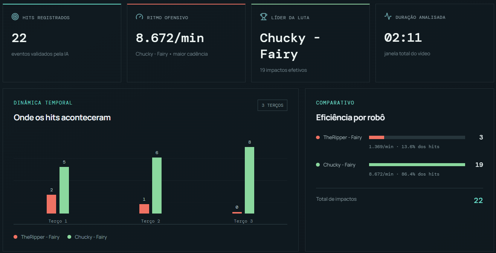

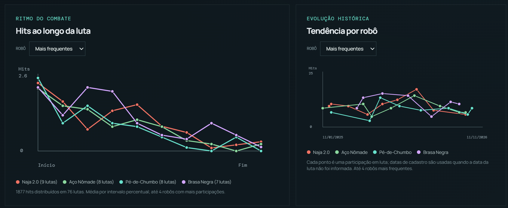

<a id="06-video-da-aplicacao"></a>

## 6. Vídeo da aplicação

[](https://youtu.be/_7RctnmemRE)

<a id="07-requisitos-funcionais-e-nao-funcionais"></a>

## 7. Requisitos funcionais e não funcionais

### Requisitos funcionais

| ID | Requisito |
|---|---|
| RF-01 | Cadastrar luta com competição, categoria, dois robôs, equipes, FPS e duração positiva. |
| RF-02 | Associar vídeo MP4, MOV, AVI ou WEBM à luta. |
| RF-03 | Importar eventos de hit por JSON, aceitar aliases cadastrados e ignorar duplicatas por frame e robô. |
| RF-04 | Iniciar/interromper análise automática de vídeo quando o detector externo estiver disponível. |
| RF-05 | Calcular hits por robô, cadência por minuto, distribuição em terços e série em dez intervalos. |
| RF-06 | Encerrar a luta, atribuir resultado por hits quando possível e permitir avaliação manual de empate. |
| RF-07 | Atualizar ELO pré-luta associado a cada robô. |
| RF-08 | Consultar histórico e filtrar análises agregadas por data, categoria, competição, robô e equipe. |
| RF-09 | Consultar e atualizar rankings RoboCore disponíveis por categoria. |
| RF-10 | Exibir sugestões pós-luta derivadas da atividade registrada e informar os limites das inferências. |
| RF-11 | Expor métricas operacionais para Prometheus. |

### Requisitos não funcionais

| ID | Requisito/condição |
|---|---|
| RNF-01 | Separar a SPA React da API REST FastAPI e manter rotas, métricas, persistência e integração com detector em módulos distintos. |
| RNF-02 | Validar payloads e tipos de mídia, retornar erros HTTP explícitos para entradas inválidas e recursos inexistentes. |
| RNF-03 | Adaptar a interface a diferentes larguras e informar carregamento, indisponibilidade e erros ao usuário. |
| RNF-04 | Manter os limites mínimos de cobertura configurados: 75% no backend e 25% em linhas, funções, branches e statements no frontend. |
| RNF-05 | Permitir inspeção local de requisições e latência por meio de Prometheus/Grafana. |
| RNF-06 | Não publicar a configuração atual sem antes adicionar autenticação/autorização, restringir CORS e proteger vídeos e `/metrics`. |
| RNF-07 | Considerar vídeos como dados potencialmente pessoais: definir base legal, informação aos participantes, controle de acesso e retenção antes de uso real/publicação. A conformidade LGPD não foi auditada nem é garantida pelo código atual. |

<a id="08-diagrama-de-casos-de-uso"></a>

## 8. Diagrama de casos de uso

O analista/equipe opera o sistema; o detector opcional fornece eventos de vídeo; a RoboCore é fonte externa do ranking; Prometheus e Grafana participam da observabilidade.

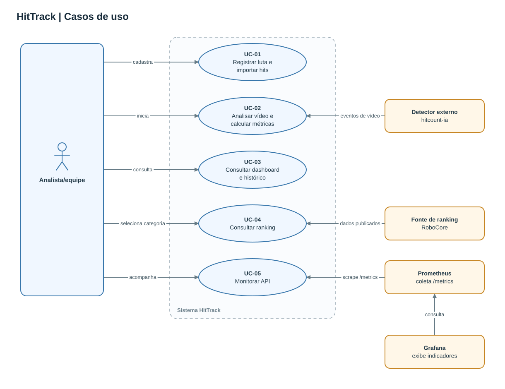

Fonte editável: [`docs/diagramas/casos-de-uso.mmd`](docs/diagramas/casos-de-uso.mmd).

Todos os SVGs de `docs/diagramas/` são gerados por [`gerar_diagramas.py`](docs/diagramas/gerar_diagramas.py), que define o layout e as rotas das setas: `python docs/diagramas/gerar_diagramas.py`.

<a id="09-fluxos-de-uso"></a>

## 9. Fluxos de uso

Os três diagramas de atividade detalham os fluxos de negócio apresentados na seção anterior.

### 9.1 Registrar luta e importar hits

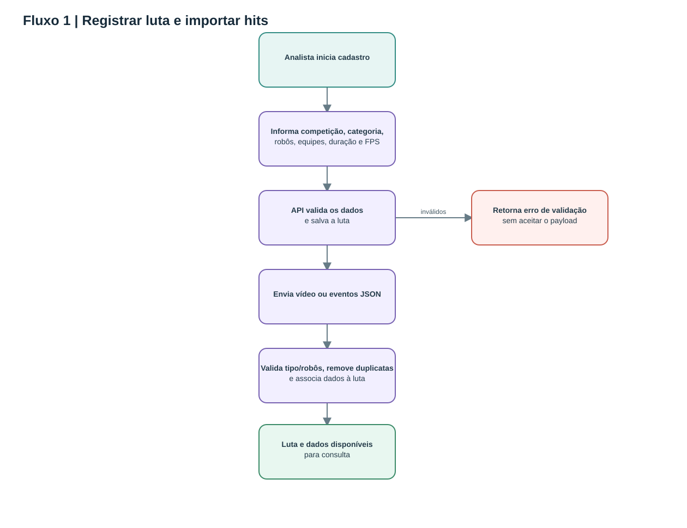

Fonte editável: [`docs/diagramas/atividade-01-ingestao.mmd`](docs/diagramas/atividade-01-ingestao.mmd).

### 9.2 Analisar vídeo e calcular métricas

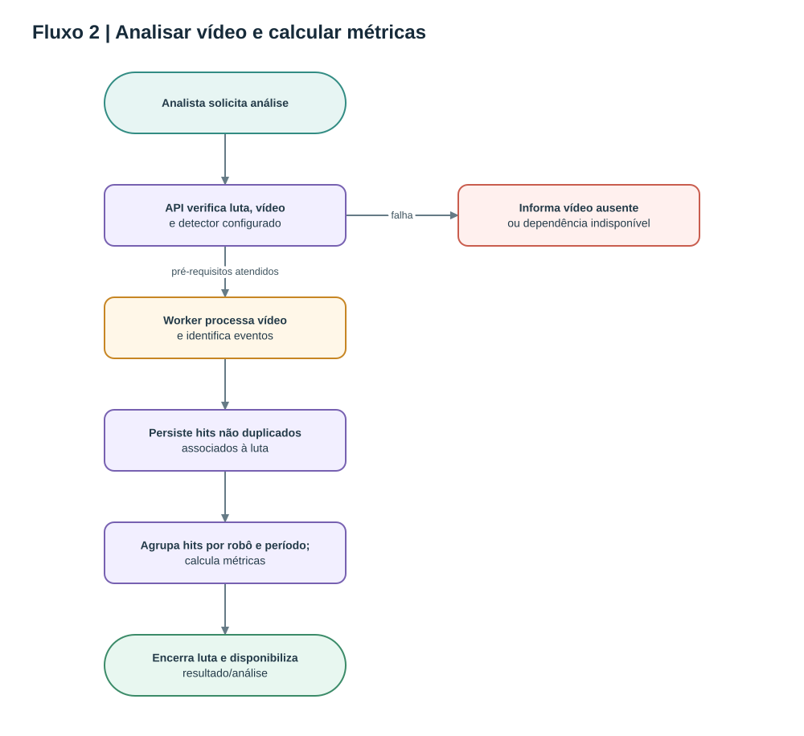

Fonte editável: [`docs/diagramas/atividade-02-analise.mmd`](docs/diagramas/atividade-02-analise.mmd).

### 9.3 Consultar dashboard e histórico

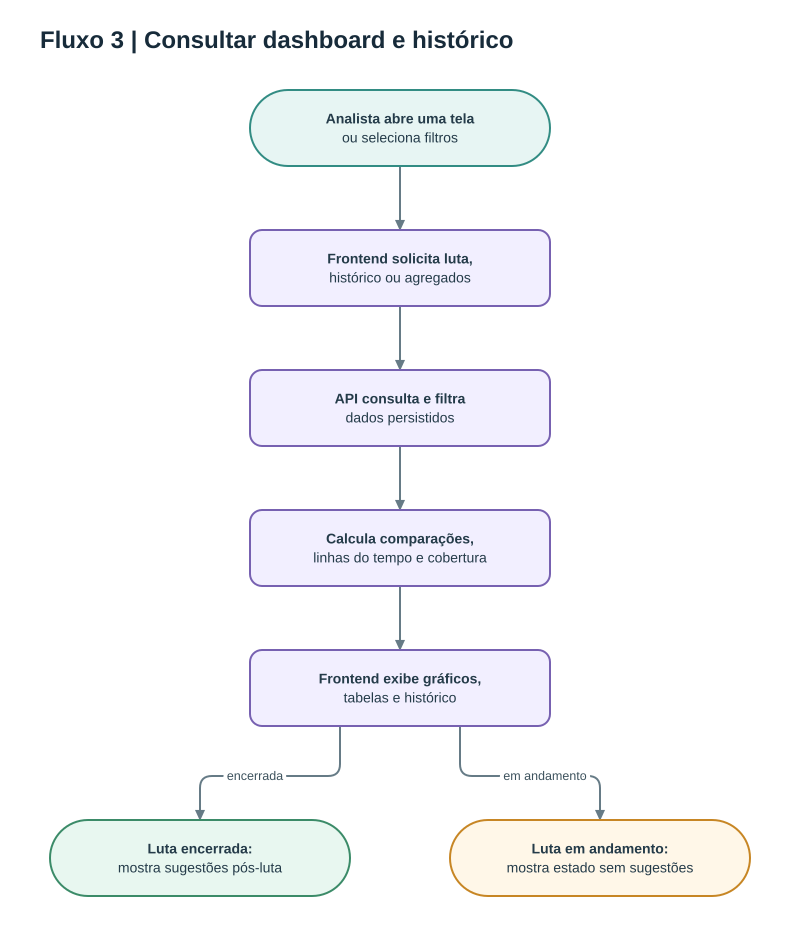

Fonte editável: [`docs/diagramas/atividade-03-dashboard.mmd`](docs/diagramas/atividade-03-dashboard.mmd).

<a id="10-estrutura-de-navegacao"></a>

## 10. Estrutura de navegação

A aplicação é uma SPA. O menu principal alterna entre as telas abaixo; algumas operações abrem formulários ou detalhes sem sair do frontend.

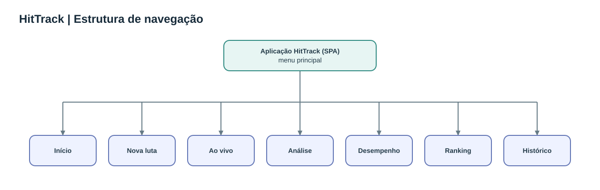

Fonte editável: [`docs/diagramas/navegacao.mmd`](docs/diagramas/navegacao.mmd).

<a id="11-arquitetura"></a>

## 11. Arquitetura

O produto usa arquitetura cliente-servidor em camadas. O frontend React chama a API REST. Rotas FastAPI validam requisições e coordenam casos de uso; serviços e módulos de domínio calculam métricas; SQLAlchemy persiste entidades em PostgreSQL. O detector é uma dependência executada no ambiente do backend, mas mantida fora deste repositório.

### C4: contexto

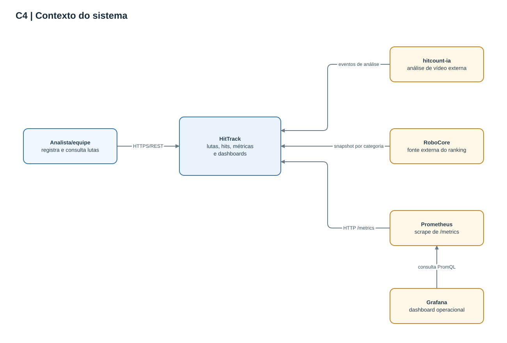

Fonte: [`docs/diagramas/c4-contexto.mmd`](docs/diagramas/c4-contexto.mmd).

### C4: contêineres

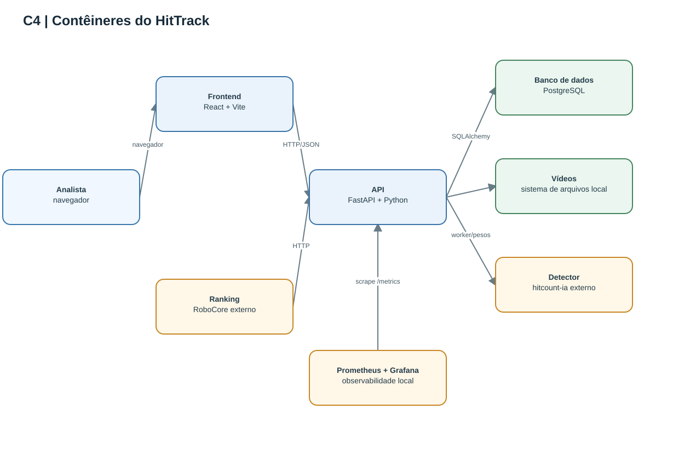

Fonte: [`docs/diagramas/c4-containers.mmd`](docs/diagramas/c4-containers.mmd).

### C4: componentes da API

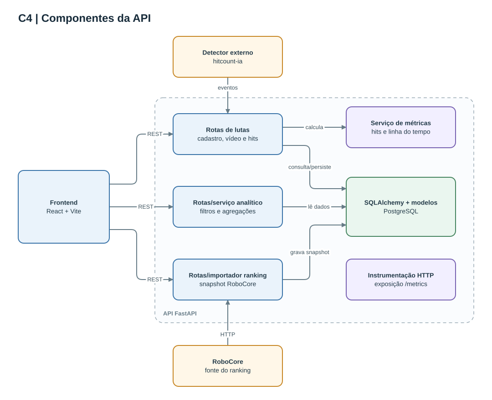

Fonte: [`docs/diagramas/c4-componentes.mmd`](docs/diagramas/c4-componentes.mmd).

### Organização do frontend (MVVM conceitual)

O frontend não implementa um framework MVVM estrito. O diagrama usa MVVM como lente de organização: componentes e páginas formam a View; hooks/estado e funções de carregamento/ações exercem o papel de ViewModel; os dados da API formam o Model consumido pela interface.

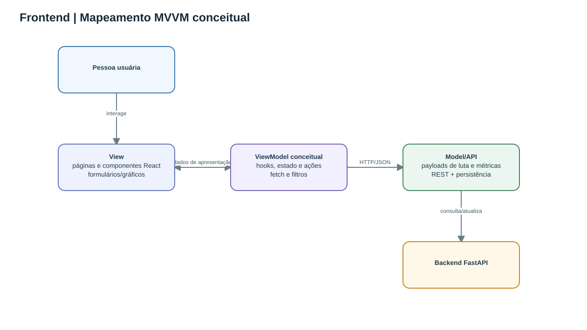

Fonte: [`docs/diagramas/mvvm.mmd`](docs/diagramas/mvvm.mmd).

### Modelo de dados (ER)

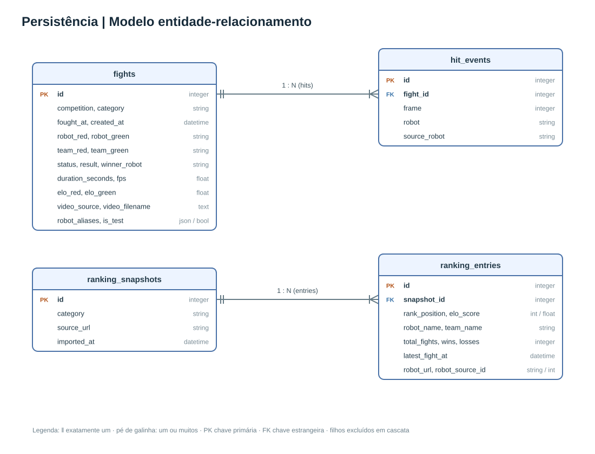

Fonte: [`docs/diagramas/modelo-er.mmd`](docs/diagramas/modelo-er.mmd).

### Pipeline de dados e fontes

Os eventos chegam por importação JSON ou detector externo; são associados à luta, normalizados por aliases e persistidos. As métricas agregadas usam somente dados efetivamente cadastrados. Rankings são importados separadamente da fonte oficial da RoboCore.

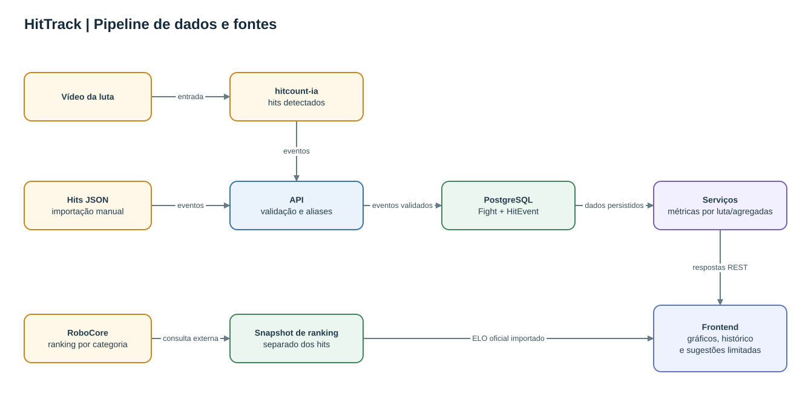

Fonte: [`docs/diagramas/pipeline-dados.mmd`](docs/diagramas/pipeline-dados.mmd).

<a id="12-stack-tecnologica"></a>

## 12. Stack tecnológica

| Camada | Tecnologias e responsabilidade |
|---|---|
| Interface | React 19, Vite 7 e Lucide React; SPA e gráficos em SVG/CSS. |
| API | Python 3.12, FastAPI, Pydantic e Uvicorn; validação e endpoints REST. |
| Persistência | SQLAlchemy 2 e PostgreSQL configurado por `DATABASE_URL`. |
| Visão computacional | Integração opcional com `hitcount-ia`, OpenCV e Ultralytics; projeto/dados/pesos são externos. |
| Fontes de dados externas | Ranking por categoria de [rank.robocore.net](https://rank.robocore.net/). |
| Testes | pytest + pytest-cov no backend; Vitest + Testing Library no frontend. |
| CI e análise | GitHub Actions; análise SonarCloud condicional à configuração dos segredos e variáveis. |
| Observabilidade local | Prometheus, Grafana e Docker Compose; API executada separadamente no host. |

<a id="13-documentacao-da-api"></a>

## 13. Documentação da API

Com o backend em execução, a especificação interativa está em `http://127.0.0.1:8000/docs` e o schema OpenAPI em `http://127.0.0.1:8000/openapi.json`. As rotas abaixo refletem os endpoints implementados.

### Lutas e métricas

| Método | Endpoint | Uso |
|---|---|---|
| `POST` | `/api/fights` | Criar luta. |
| `GET` | `/api/fights` | Listar histórico e resumo de hits. |
| `GET` | `/api/fights/{fight_id}` | Consultar luta. |
| `POST` | `/api/fights/{fight_id}/video` | Enviar vídeo multipart (MP4, MOV, AVI ou WEBM). |
| `GET` | `/api/fights/{fight_id}/video` | Obter vídeo associado. |
| `POST` | `/api/fights/{fight_id}/hits` | Importar eventos JSON. |
| `POST` | `/api/fights/{fight_id}/hits/upload` | Importar arquivo JSON multipart. |
| `GET` | `/api/fights/{fight_id}/metrics` | Calcular métricas daquela luta. |
| `PATCH` | `/api/fights/{fight_id}/result` | Registrar vencedor manual após encerrar luta. |
| `PATCH` | `/api/fights/{fight_id}/elo` | Atualizar ELO pré-luta dos competidores. |
| `POST` | `/api/fights/{fight_id}/analyze` | Iniciar análise automática; requer vídeo e detector. |
| `POST` | `/api/fights/{fight_id}/stop` | Encerrar análise/luta em andamento. |

### Desempenho, ranking e análise ao vivo

| Método | Endpoint | Uso |
|---|---|---|
| `GET` | `/api/analytics` | Métricas agregadas; aceita `start_date`, `end_date`, `category`, `competition`, `robot`, `team` e `include_test_data`. |
| `GET` | `/api/rankings?category={category}` | Obter último snapshot salvo para a categoria. |
| `POST` | `/api/rankings/refresh?category={category}` | Atualizar ranking da fonte RoboCore. |
| `GET` | `/hits` | Contagens atuais durante análise. |
| `GET` | `/analysis/status` | Estado/frame da análise. |
| `GET` | `/stream` | Stream MJPEG da análise ao vivo. |
| `GET` | `/metrics` | Métricas operacionais Prometheus (montagem separada da API REST). |
| `GET` | `/` | Estado básico da API. |

Os controles legados do worker de demonstração também existem em `GET /start`, `GET /play`, `GET /pause`, `GET /reset` e `GET /stop`. Eles atuam sobre o worker de vídeo do processo e são distintos das rotas `POST /api/fights/{fight_id}/analyze` e `POST /api/fights/{fight_id}/stop`.

Parâmetros de data do endpoint agregado são inclusivos. A API responde `422` se a data inicial for posterior à final. A resposta de métricas ausentes não deve ser interpretada como prova de zero hits.

Exemplo mínimo de eventos para `POST /api/fights/{fight_id}/hits`:

```json
{
  "events": [
    { "frame": 45, "robot": "vermelho" },
    { "frame": 132, "robot": "azul" }
  ]
}
```

O cadastro deve identificar os robôs/equipes, categoria, FPS e duração. Os nomes de `robot` em cada evento precisam corresponder a um robô cadastrado ou a um alias válido.

<a id="14-decisoes-tecnicas-mudancas-e-trade-offs"></a>

## 14. Decisões técnicas, mudanças e trade-offs

- **Cliente-servidor em camadas, não MVC estrito:** rotas FastAPI exercem responsabilidades de controller; modelos SQLAlchemy representam entidades; os módulos backend calculam métricas. A separação é simples, mas serviços e coordenação ainda dependem do estado da aplicação.
- **PostgreSQL obrigatório em execução normal:** `DATABASE_URL` é exigido pela configuração da aplicação. SQLite aparece nos testes isolados, mas não é o banco documentado para uso normal.
- **Detector externo:** `hitcount-ia` fica fora deste repositório. Isso mantém o escopo do produto separado do modelo e seus pesos, mas exige provisionamento adicional para executar a API atual.
- **Rankings são snapshots:** o serviço importa a fonte RoboCore, guarda a data da coleta e preserva dados anteriores se a fonte estiver indisponível. O ELO oficial não é calculado pelo HitTrack.
- **ELO pré-luta e resultados são dados diferentes:** os valores pré-luta são cadastrados/importados, e o vencedor pode ser derivado dos hits ou avaliado manualmente em caso de empate. Correlação não equivale a causalidade.
- **Sem inferências em dados ausentes:** por exemplo, um registro sem eventos não é automaticamente convertido em zero observado.
- **Análise defensiva limitada:** sugestões atuais usam somente a diferença temporal de hits registrados; não existe sensor/label de ataque recebido ou defesa. A interface qualifica esses apontamentos como indícios.
- **RFC e implementação:** o RFC-001 descreve os fluxos e as métricas agregadas; este README consolida requisitos, API e operação e documenta também o ranking RoboCore, lutas de teste e sugestões pós-luta presentes na implementação atual. Manter o RFC e esta documentação alinhados em futuras revisões.
- **Trade-off de execução local:** a URL da API e o armazenamento de vídeos são locais; isso simplifica a demonstração, mas não constitui configuração segura ou escalável para exposição pública.

<a id="15-cicd-testes-qualidade-privacidade-e-monitoramento"></a>

## 15. CI/CD, testes, qualidade, privacidade e monitoramento

### CI/CD e qualidade

O workflow [`.github/workflows/ci.yml`](.github/workflows/ci.yml) roda no push/PR para `main` e manualmente. Ele configura Python 3.12 e Node.js 22, executa testes e cobertura, lint e build de produção no frontend e testes/cobertura do backend. SonarCloud roda quando `SONAR_ORGANIZATION`, `SONAR_PROJECT_KEY` e `SONAR_TOKEN` estão configurados. O workflow configura CI; não publica a aplicação e não realiza deploy contínuo.

Os testes cobrem o backend do HitTrack e o frontend. O código e os pesos externos de `hitcount-ia` não fazem parte do cálculo de cobertura.

```powershell
# Raiz do repositório
.\.venv\Scripts\python.exe -m pytest

# Frontend
Set-Location frontend
npm ci
npm run test:coverage
npm run lint
npm run build
```

O pytest falha abaixo de 75% de cobertura backend. O Vitest exige pelo menos 25% em linhas, funções, branches e statements. Esses limites são configuração do projeto; resultados correntes devem ser conferidos nos artefatos do workflow, e não inferidos a partir dos limites.

### Capturas de qualidade e testes

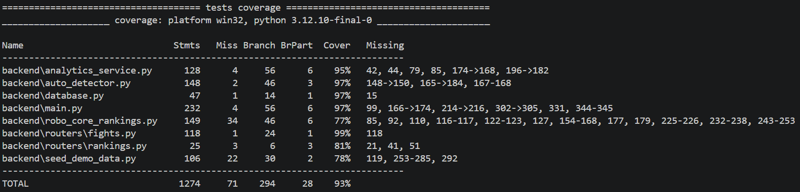

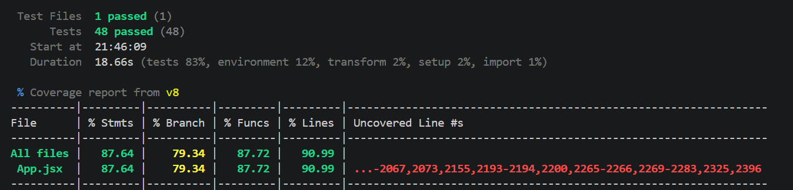

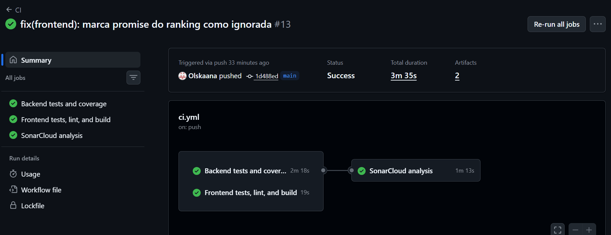

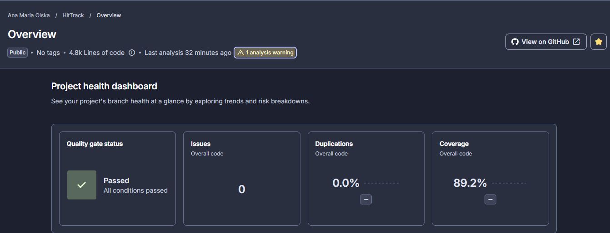

### Privacidade e LGPD

Não há autenticação, autorização ou controles de acesso por equipe. Vídeos podem conter imagens e vozes de pessoas e, portanto, podem envolver dados pessoais. O repositório não implementa um fluxo para consentimento, base legal, acesso/retificação ou exclusão de dados. Antes de coletar ou compartilhar gravações, a equipe responsável deve definir finalidade, base legal, informação aos participantes, acesso restrito, retenção e descarte conforme orientação institucional e LGPD. Esta documentação não representa parecer jurídico nem certificação de conformidade.

### Monitoramento local

A API expõe métricas em `/metrics`; o compose em `monitoring/` sobe somente Prometheus e Grafana. A stack é local e não configura observabilidade de uma aplicação publicada. Consulte a configuração em [`monitoring/docker-compose.yml`](monitoring/docker-compose.yml), [`monitoring/prometheus.yml`](monitoring/prometheus.yml) e o dashboard em [`monitoring/grafana/dashboards/hittrack-overview.json`](monitoring/grafana/dashboards/hittrack-overview.json).

<a id="16-resultados-e-validacao-com-o-cliente"></a>

## 16. Resultados e validação com o cliente

### Resultado técnico disponível

O produto implementa cadastro e ingestão, métricas por luta, análise agregada/histórica, importação de ranking e uma SPA de demonstração. O workflow de CI executa verificações automatizadas para o código do repositório. A cobertura efetiva deve ser apresentada com o relatório produzido na execução usada para a entrega.

### Validação com cliente/equipe

O cliente forneceu um vídeo de uma luta para validar os dados apresentados pelo HitTrack. Os hits identificados foram conferidos manualmente com base no vídeo, permitindo comparar os eventos registrados pela aplicação com os impactos observados. Após a apresentação dos resultados, o cliente demonstrou satisfação com a aplicação.

A conferência manual foi usada como validação dos hits desse vídeo.

<a id="17-aderencia-a-linha-web-app"></a>

## 17. Aderência à linha Web App

| Requisito da linha | Como o HitTrack atende | Onde ver |
|---|---|---|
| Sistema acessível | Execução local documentada; não há URL pública publicada. | [Execução local](#20-execucao-local-e-dependencias) |
| Funcionalidades completas e reais conforme o escopo | Cadastro de lutas, ingestão de hits, métricas, análise histórica, rankings e sugestões com limitações explicitadas. | [Funcionalidades](#05-funcionalidades-diferencial-e-inovacao), [requisitos](#07-requisitos-funcionais-e-nao-funcionais) |
| Interface funcional e navegável | Aplicação React/Vite com análise individual, painel Desempenho e navegação documentada. | [Navegação](#10-estrutura-de-navegacao), [análise da luta](docs/img/analise-da-luta.png), [Desempenho](docs/img/desempenho.png) |
| Arquitetura definida | Separação cliente-servidor em camadas: React, API FastAPI e PostgreSQL. | [Arquitetura e diagramas C4](#11-arquitetura) |
| Organização modular do código | Backend organizado em rotas, serviços, modelos e esquemas; frontend em páginas, componentes e hooks. | [Arquitetura](#11-arquitetura), [código-fonte](https://github.com/Olskaana/HitTrack) |
| Código-fonte com histórico de commits | Repositório público no GitHub. | [Commits](https://github.com/Olskaana/HitTrack/commits) |
| Requisitos funcionais | Requisitos RF-01 a RF-11 documentados. | [Requisitos funcionais](#07-requisitos-funcionais-e-nao-funcionais) |
| Casos de uso | Diagrama e fluxos de uso para os principais atores e cenários. | [Casos de uso](#08-diagrama-de-casos-de-uso), [fluxos](#09-fluxos-de-uso) |
| Diagrama de arquitetura (C4) | Diagramas de contexto, contêineres e componentes da API. | [Arquitetura](#11-arquitetura) |
| Instruções de instalação e execução | Pré-requisitos, configuração local e comandos de execução documentados. | [Instalação e deploy](#19-instalacao-e-deploy), [execução local](#20-execucao-local-e-dependencias) |
| Pelo menos três fluxos de negócio completos | Registrar/importar luta, analisar vídeo e consultar dashboard/histórico. | [Fluxos de uso](#09-fluxos-de-uso) |
| Cobertura de testes | Capturas da execução mostram 93% no backend e 90,99% de linhas no frontend; o workflow de CI está aprovado. | [Backend](docs/img/cobertura-backend.png), [frontend](docs/img/cobertura-frontend.png), [GitHub Actions](docs/img/github-actions.png) |
| Qualidade estática | Quality Gate aprovado no SonarCloud, conforme a captura registrada. | [SonarCloud](docs/img/sonarcloud.png), [workflow de CI](.github/workflows/ci.yml) |
| Monitoramento | Endpoint Prometheus e stack local com Prometheus e Grafana. | [Monitoramento](#15-cicd-testes-qualidade-privacidade-e-monitoramento) |

O projeto ainda não tem hospedagem pública nem avaliação estruturada de usabilidade documentada. O cliente avaliou os dados exibidos e demonstrou satisfação durante a apresentação da aplicação, conforme registrado na [seção 16](#16-resultados-e-validacao-com-o-cliente).

<a id="18-trabalhos-futuros"></a>

## 18. Trabalhos futuros

1. Realizar testes de usabilidade com equipes e documentar os resultados;
2. Registrar evidências autorizadas de validação e demonstração;
3. Parametrizar a origem da API e definir estratégia segura de publicação, se necessária;
4. Implementar autenticação, autorização por equipe, política de retenção e proteção de vídeos/métricas;
5. Incluir labels específicos para ataques recebidos, defesas e outros eventos, antes de formular recomendações defensivas conclusivas;
6. Validar o detector em amostra representativa e medir precisão/recall com protocolo documentado;
7. Relacionar histórico oficial RoboCore e lutas sem confundir snapshots com ELO pré-luta;
8. Considerar armazenamento persistente compartilhado para vídeos e processos de análise assíncronos.

<a id="19-instalacao-e-deploy"></a>

## 19. Instalação e deploy

### Estado atual

Não há endpoint hospedado publicado neste README. As instruções abaixo preparam uma execução local; os passos de deploy são um checklist futuro e não configuram uma infraestrutura.

### Pré-requisitos para instalação

- Windows PowerShell, Python 3.12 e Node.js 22;
- PostgreSQL acessível e banco criado previamente;
- Clone separado do projeto `hitcount-ia`, com `detector.CamWorker`, dependências, pesos e dados necessários;
- Opcional: Docker Desktop para executar Prometheus/Grafana localmente.

O backend importa `detector.CamWorker` ao iniciar. Portanto, instalar somente `backend/requirements.txt` não basta: `AI_PROJECT_DIR` deve apontar para o clone externo. O projeto externo não é fornecido por este repositório.

Na raiz:

```powershell
py -3.12 -m venv .venv
.\.venv\Scripts\python.exe -m pip install -r backend\requirements.txt
Copy-Item backend\.env.example backend\.env
```

Edite `backend/.env`, configure `DATABASE_URL` para o PostgreSQL e `AI_PROJECT_DIR` para o caminho do detector. Nunca coloque senhas, tokens ou pesos privados no README ou no Git.

### Checklist para futuro deploy

Antes de publicar, será necessário:

1. Provisionar API, frontend, banco persistente, armazenamento compartilhado de vídeos e o detector/pesos;
2. Configurar a URL HTTPS da API no frontend e restringir CORS aos domínios necessários;
3. Implementar autenticação/autorização e limitar upload, acesso a vídeos e rota `/metrics`;
4. Configurar segredos fora do código, backups, retenção, atualização de schema e política de dados pessoais;
5. Executar workflow CI, validar o fluxo completo no ambiente de homologação e configurar monitoramento protegido.

Não exponha a configuração de desenvolvimento atual diretamente à Internet: ela usa uma URL local no frontend, CORS amplo, sem autenticação e arquivos de vídeo locais.

<a id="20-execucao-local-e-dependencias"></a>

## 20. Execução local e dependências

### Banco e API

1. Crie no PostgreSQL o banco e usuário indicados pela sua configuração local de `DATABASE_URL`;
2. Confirme que `backend/.env` aponta para o PostgreSQL e para o clone `hitcount-ia`;
3. Inicie a API na raiz do repositório:

```powershell
.\.venv\Scripts\python.exe -m uvicorn main:app --app-dir backend --host 127.0.0.1 --port 8000
```

### Frontend

Em outro terminal:

```powershell
Set-Location frontend
npm ci
npm run dev
```

Abra `http://localhost:5173`. A documentação OpenAPI fica em `http://127.0.0.1:8000/docs`.

### Dados de demonstração

Depois de iniciar o banco/API e criar o schema, o seguinte comando pode incluir o conjunto sintético, identificável como fictício:

```powershell
.\.venv\Scripts\python.exe backend\seed_demo_data.py --apply
```

Opcionalmente, `--include-test-data` acrescenta também lutas sintéticas marcadas como teste. Confira os avisos do comando antes de executar; não use os dados gerados como resultados de cliente ou evidência de desempenho real.

### Monitoramento local

Com a API em execução e `/metrics` acessível, defina uma senha de desenvolvimento e inicie a stack a partir da raiz:

```powershell
$env:GRAFANA_ADMIN_PASSWORD = Read-Host "Senha local do Grafana"
docker compose -f monitoring/docker-compose.yml up -d
```

Prometheus: `http://localhost:9090`; Grafana: `http://localhost:3000`. Para encerrar: `docker compose -f monitoring/docker-compose.yml down`. A stack é local e não configura monitoramento para uma publicação.

<a id="21-contribuicoes-externas"></a>

## 21. Contribuições externas

- **`hitcount-ia`:** projeto independente que fornece o detector e recursos de visão computacional; não está incorporado nem distribuído por este repositório. Consulte os termos e instruções do projeto de origem antes de utilizá-lo.
- **RoboCore:** fonte pública consultada para os rankings por categoria. A importação não altera os rankings nem os ELOs registrados no HitTrack.
- **Dependências de software:** FastAPI, React, SQLAlchemy, OpenCV, Ultralytics e demais bibliotecas mantêm licenças e avisos próprios, listados nos respectivos pacotes e manifestos.
- **Conteúdo técnico/textual:** manter as declarações de autoria e uso de ferramentas de apoio revisadas pela autora; atribuir separadamente quaisquer imagens, vídeos, modelos ou dados de terceiros adicionados à pasta `docs/img/`.
- **Apoio de IA generativa:** a documentação anterior do projeto declarou uso de Claude (Anthropic), e esta reorganização contou também com apoio do Copilot. A autora revisa o conteúdo técnico e responde pela versão publicada.

<a id="22-referencias"></a>

## 22. Referências

- [RFC técnico do HitTrack](docs/rfc/RFC-001.md).
- [Repositório HitTrack](https://github.com/Olskaana/HitTrack).
- [Rankings RoboCore](https://rank.robocore.net/).
- [Mobalytics](https://mobalytics.gg/).
- [Tableau](https://www.tableau.com/).
- [Bold BI](https://www.boldbi.com/).
- [FastAPI: documentação](https://fastapi.tiangolo.com/).
- [React: documentação](https://react.dev/).
- [PostgreSQL: documentação](https://www.postgresql.org/docs/).
- [SQLAlchemy: documentação](https://docs.sqlalchemy.org/).
- [Prometheus: documentação](https://prometheus.io/docs/).
- [Grafana: documentação](https://grafana.com/docs/).
- [Lei Geral de Proteção de Dados (Lei nº 13.709/2018)](https://www.planalto.gov.br/ccivil_03/_ato2015-2018/2018/lei/l13709.htm).

<a id="23-autora"></a>

## 23. Autora

**Ana Maria Olska**  
Universidade Católica de Santa Catarina  
Jaraguá do Sul, Santa Catarina, Brasil

Contato: [anamaria.olska@gmail.com](mailto:anamaria.olska@gmail.com)

Projeto acadêmico: PAC 8, linha Web Apps, 2026/2.
